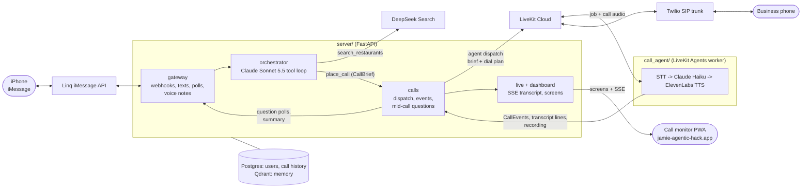

# Eve: call-for-me iMessage agent

A personal assistant you text on iMessage. Tell it what you need ("book a table for four tomorrow at eight at the usual Italian place") and it phones the business for you, in German or English, then texts you the result.

**Live: [jamie-agentic-hack.app](http://jamie-agentic-hack.app)** (call monitor PWA; sign in with the phone number you text Eve from)

Built at the Agentic AI Hack, Berlin, 24 Oct 2026.

## What it does

1. Understands text messages and voice notes.
2. Asks clarifying questions as native iMessage polls.
3. Remembers you: your name, your usual places, your preferences.
4. Finds restaurants on the web when you don't have one in mind.
5. Calls the business for you. If they offer something outside the brief (for example 21:00 instead of 20:00), it puts them on hold, sends you a live poll and relays your answer. Open questions like "what's your surname?" can be answered by just texting back.
6. Texts you a short summary when the call ends.
7. Shows every call in a web app: live status, any question waiting on you, the timeline and a live transcript while the call runs.

## Architecture



Two Python processes plus the web app:

- **`server/`** receives iMessages, runs the orchestrator, keeps memory and call history, places calls and serves the dashboard API.
- **`call_agent/`** is the LiveKit worker that holds the actual phone conversation. It dials out, talks, asks you through the server when it needs a decision, and posts the result.
- **`web/`** is the call monitor PWA (Vite, React, OpenUI). The server builds its screens, and live transcripts stream in over Server-Sent Events.

The two processes share `CallBrief` and `CallEvent` from `common/contracts.py`. See [CLAUDE.md](CLAUDE.md) for the full spec.

### Safe mode

`SAFE_MODE` (server, on by default) only changes where a call goes. Search and the conversation work the same.

- **On:** every call rings `SAFE_MODE_NUMBER`, a teammate playing the restaurant. If it isn't set, no call is placed.
- **Off:** the restaurant's real number is dialled, but only after you confirm it in a poll. Premium-rate numbers are refused, and the agent always says it is a digital assistant.

## Stack

| Layer | Choice |
| --- | --- |
| iMessage | Linq API v3 |
| Orchestrator LLM | Claude Sonnet 5.5 (LangGraph tool loop) |
| Call LLM | Claude Haiku |
| Restaurant search | DeepSeek Search API |
| Voice-note STT | ElevenLabs Scribe v2 |
| Call STT | ElevenLabs Scribe v2 realtime (Reson8 optional) |
| TTS | ElevenLabs |
| Telephony | Twilio SIP trunk into LiveKit Cloud |
| Memory | Qdrant |
| Users, call history, recordings | Postgres |
| Call monitor | Vite + React + OpenUI, Tailwind, shadcn/ui |

## Setup

Run Postgres, Qdrant, the server and the PWA locally:

```
docker compose up --build
curl localhost:8000/health
```

The call monitor is at `http://localhost:8080/app/`. Enter your phone number and the 6-digit code texted to it. In fake mode, the code is in the server log.

Full setup:

1. Copy `.env.example` to `.env` and fill in the keys.
2. Set `SAFE_MODE_NUMBER` to the teammate playing the restaurant.
3. Expose the server (ngrok locally) and put the URL in `SERVER_PUBLIC_URL`.
4. Start `server/` and `call_agent/`.

Without phones: every outside service has a fake, used by default. Send `/call` to `POST /dev/inbound` to play a scripted call, live transcript included (see CLAUDE.md).

By default the call agent does not announce itself as an AI in its opening line, because the demo calls our own teammates. It never claims to be human, and says so truthfully if asked. Set `DISCLOSE_AI=true` to make it introduce itself as a digital assistant up front. With `SAFE_MODE` off it always does.

## Docs

- [Roadmap](docs/roadmap.md)
- [Team split](docs/team-split.md)
- [Project spec and conventions](CLAUDE.md)
